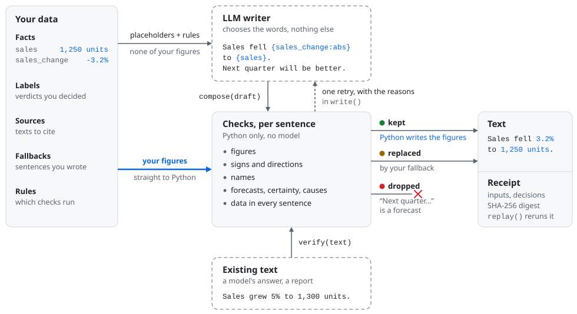

<p align="center">
  <picture>
    <source media="(prefers-color-scheme: dark)" srcset="https://raw.githubusercontent.com/Jegoba90/anti-hallucination/main/assets/brand/header-dark.svg">
    <source media="(prefers-color-scheme: light)" srcset="https://raw.githubusercontent.com/Jegoba90/anti-hallucination/main/assets/brand/header.svg">
    
  </picture>
</p>

<p align="center">
  <strong>Your numbers decide. The AI only writes.</strong><br>
  Turn your data into AI-written reports with checked figures, sentence-level decisions, and receipts you can replay.
</p>

<p align="center">
  <a href="https://pypi.org/project/antihallucination/"></a>
  <a href="https://github.com/Jegoba90/anti-hallucination/actions/workflows/tests.yml"></a>
  <a href="https://pypi.org/project/antihallucination/"></a>
  <a href="https://github.com/Jegoba90/anti-hallucination/blob/main/LICENSE"></a>
  <a href="#scope-and-limitations"></a>
</p>

<p align="center">
  <a href="#quick-start">Quick start</a> &nbsp;·&nbsp;
  <a href="#examples">Examples</a> &nbsp;·&nbsp;
  <a href="#use-with-mcp">MCP setup</a> &nbsp;·&nbsp;
  <a href="#run-it-as-a-service">Service</a> &nbsp;·&nbsp;
  <a href="#what-it-checks">Checks</a> &nbsp;·&nbsp;
  <a href="https://github.com/Jegoba90/anti-hallucination/blob/main/CONTRIBUTING.md">Contribute</a>
</p>

## Reports built from your data

A sales summary should use the sales you measured. A support report should
keep the customer counts in your tickets. Your code owns the figures and
verdicts; Anti-Hallucination lets a writer put them into words, then checks
each sentence before it goes out.

| What you need | What you get |
|---|---|
| Keep figures under your control | Python fills `{placeholders}` from your facts instead of asking a model to type the values |
| Check a draft you already have | `verify()` flags unsupported figures, conflicting directions, and other rule violations |
| Decide what happens when a check fails | Drop the sentence or replace it with a fallback you supplied |
| Explain the output | A decision for each sentence, plus a receipt you can verify and replay |
| Fit your workflow | Python library, command line, and an MCP server; English and Spanish checks |

Use it for sales reports, SaaS metrics, finance summaries, and support digests.
The checks run locally and use the Python standard library. The package also
installs `httpx` for optional calls to model providers.

## Quick start

**Python 3.11+** · The example below runs locally without an API key.

```bash
pip install antihallucination
```

```python
from antihallucination import Fact, compose, verify

facts = [
    Fact("sales", 1250, unit="units", subject="sales"),
    Fact("sales_change", -3.2, unit="%", change=True, subject="sales"),
]

# The writer uses placeholders. Python fills the figures.
draft = "Sales fell {sales_change:abs} to {sales}. Next quarter will be better."
result = compose(draft, facts, locale="en")
print(result.text)
# Sales fell 3.2% to 1,250 units.

# Check an existing draft against the same facts.
report = verify("Sales grew 5% to 1,300 units.", facts, locale="en")
print([(finding.check, finding.span) for finding in report.findings])
# [('unbacked_number', '5%'), ('unbacked_number', '1,300'), ('direction_contradiction', 'grew')]
```

The forecast is dropped. The measured decline stays. In the second draft,
both invented figures and the conflicting direction are flagged.
`result.decisions` explains what happened to each sentence;
`result.receipt` records the inputs and decisions with a SHA-256 digest.

### Let a model write the draft

Install the Claude extra and set `ANTHROPIC_API_KEY`:

```bash
pip install "antihallucination[claude]"
```

Using the `facts` from above:

```python
from antihallucination import write
from antihallucination.writers import ClaudeWriter

written = write(
    "A two-sentence sales summary for the board.",
    facts,
    writer=ClaudeWriter(),
    locale="en",
)
print(written.text)
```

`write()` gives the writer placeholder names, formatting rules, and change
directions while withholding the numeric values in `Fact.value`. It checks
the draft and can ask for another attempt with the reasons a sentence failed.
Source text, labels, and your brief can still contain numbers.

Prefer another provider? `OpenAICompatibleWriter.openai(model)`,
`.groq(model)`, and `.ollama(model)` use the same writing pipeline. You can
also pass any function with the signature `(system, prompt) -> str`.

## How it works

The LLM only chooses the words: it writes placeholders instead of your figures,
and Python checks each sentence of the draft and writes the figures into the
sentences that pass. `verify()` runs the same checks on a text that already has
its figures.

<p align="center">
  <picture>
    <source media="(prefers-color-scheme: dark)" srcset="https://raw.githubusercontent.com/Jegoba90/anti-hallucination/main/assets/how-it-works-dark.svg">
    <source media="(prefers-color-scheme: light)" srcset="https://raw.githubusercontent.com/Jegoba90/anti-hallucination/main/assets/how-it-works.svg">
    
  </picture>
</p>

- **Facts** hold values your code computed. **Labels** hold verdicts your rules
  chose, such as “a slight decline”; `classify()` can choose them by threshold.
- **Computed changes** come from two facts: `percent_change()` and
  `difference()` compute them exactly, so neither you nor the writer does the
  arithmetic. The receipt records them as computed, and from which facts.
- **Sources** hold evidence a draft can cite with `[id]`. A citation provides
  context for the checks; it does not prove that the sentence follows from
  the source.
- **Fallbacks** are sentences you wrote. A failed sentence can be replaced by
  a fallback for the same subject; otherwise it is dropped.
- **Receipts** keep the inputs, decisions, and a digest so you can check their
  consistency and replay the run.

### What it checks

| Check | `compose()` — a draft with placeholders | `verify()` — existing text |
|---|---|---|
| Figures | Python fills placeholders; figures copied from a cited source are also allowed | Each figure must match a fact at the written precision, or occur in a label or permitted source |
| Signs and directions | A word such as “fell” or “cayeron” must agree with the change; unsupported movement is flagged | Same |
| Names | Checks proper names against facts, labels, sources, and `known_names` | Same |
| Forecasts, certainty, causes | Flags phrases from English and Spanish word lists by default | Same |
| Data in every sentence | Requires a placeholder, a checked direction, or a source citation | Requires a figure, a verdict from your data, a checked direction, or a citation |

Number parsing follows the locale: `1.250` means a thousand two hundred and
fifty in Spanish, while `1,250` means that in English. It also handles scales
such as `1,2 millones` and `4bn`, and a vocabulary of numbers written in words.

## Examples

Each example includes a data file, a draft with placeholders, and a text
written with figures. The test suite checks their expected outputs.

| Example | What it demonstrates |
|---|---|
| [SaaS metrics](https://github.com/Jegoba90/anti-hallucination/tree/main/examples/saas) · English | Invented revenue figures, a cause, and a forecast are caught; supplied fallbacks keep the report useful |
| [Support digest](https://github.com/Jegoba90/anti-hallucination/tree/main/examples/support) · English | A ticket summary changes 23 customers to 32 and invents a cause; checks catch both |
| [Sales report](https://github.com/Jegoba90/anti-hallucination/tree/main/examples/sales) · Spanish | A draft claims growth while the supplied change is −3.2% |
| [Python walkthrough](https://github.com/Jegoba90/anti-hallucination/blob/main/examples/sales_report.py) | Run both modes, inspect the decisions, and replay the receipt |

## Use with MCP

Use the same checks from Claude Code, Claude Desktop, or another MCP client.
The server exposes four tools and makes no model or network calls itself.

```bash
pip install "antihallucination[mcp]"
```

**Claude Code:**

```bash
claude mcp add --transport stdio --scope user anti-hallucination -- python -m antihallucination.mcp_server
```

<details>
<summary><strong>Claude Desktop configuration</strong></summary>

Add this to `claude_desktop_config.json`:

```json
{
  "mcpServers": {
    "anti-hallucination": {
      "command": "python",
      "args": ["-m", "antihallucination.mcp_server"]
    }
  }
}
```

The file is in `%APPDATA%\Claude\` on Windows and
`~/Library/Application Support/Claude/` on macOS. Use the Python executable
where you installed the extra; this may be `python3` or an absolute path.
`antihallucination-mcp` launches the same server.

</details>

| Tool | Purpose |
|---|---|
| `prepare_report` | Build the writing instructions with placeholders and rules |
| `compose_report` | Fill the draft, run checks, and return text, decisions, and a receipt |
| `verify_text` | Check an existing text against the supplied data |
| `check_receipt` | Verify receipt consistency and replay its decisions |

**The assistant supplies the data.** It may already have seen, calculated, or
changed the values. The server checks the text against what it receives; it
does not establish where those values came from. What it can take off the
assistant is the arithmetic: a change between two figures goes in as
`{"compute": "percent_change", "from": "...", "to": "..."}`, and the server
computes it. Each receipt shows which figures were computed and which were
supplied. Client and model privacy policies still apply.

## Run it as a service

For teams that would rather call an endpoint than add Python to their agent.
One container serves the same checks two ways: a REST API for agents in any
language, and MCP over HTTP for Claude Code and other MCP clients. It calls no
model, keeps nothing between requests, and runs inside your own network.

```bash
docker run -d -p 8000:8000 -e ANTIHALLUCINATION_TOKEN=<a long random string> \
  ghcr.io/jegoba90/anti-hallucination
```

The service ships with v0.3.0, and from then on each release publishes the
image. `docker build -t anti-hallucination .` builds it from this repository.
Without Docker, run `pip install "antihallucination[server]"` and then
`antihallucination serve`.

| Route | Body | Does |
|---|---|---|
| `POST /v1/compose` | `draft`, `data`, `locale`, `writer` | Fill a draft with placeholders and keep what passes |
| `POST /v1/verify` | `text`, `data`, `locale`, `writer` | Check a text that already has its figures |
| `POST /v1/prepare` | `brief`, `data`, `locale` | The placeholders and rules to hand a writer |
| `POST /v1/receipt` | `receipt`, `data` | Verify a receipt and replay its decision |
| `/mcp` | | The same four tools over MCP |
| `GET /health` | | Status and version |

`data` is the JSON of the command line's data file, and its `locale` is the
default; `writer` names who wrote the text, for the receipt. Responses match
the MCP tools' output.

```bash
curl -s localhost:8000/v1/verify \
  -H "Authorization: Bearer $ANTIHALLUCINATION_TOKEN" -H "Content-Type: application/json" \
  -d '{"text": "Sales grew 5% to 1,300 units.", "locale": "en", "data": {"facts": [
        {"name": "sales", "value": 1250, "unit": "units", "subject": "sales"},
        {"name": "sales_change", "value": -3.2, "unit": "%", "change": true, "subject": "sales"}]}}'
```

To connect Claude Code:

```bash
claude mcp add --transport http anti-hallucination http://your-host:8000/mcp \
  --header "Authorization: Bearer <token>"
```

Every route except `/health` needs the token. Without
`ANTIHALLUCINATION_TOKEN` the service only starts on `127.0.0.1`, so the
container will not start without one. Requests over 256 KB are refused; set
`ANTIHALLUCINATION_MAX_BODY` or `--max-body` to change the limit.

## Command line

```bash
antihallucination verify examples/saas/written_by_an_ai.txt --data examples/saas/data.json
antihallucination compose examples/saas/draft.txt --data examples/saas/data.json --receipt receipt.json
antihallucination receipt receipt.json --data examples/saas/data.json
antihallucination write --data examples/saas/data.json --brief "A short monthly update for the team."
```

`python -m antihallucination` works too. The data file holds facts, labels,
sources, fallbacks, and known names; its format is documented in
[`antihallucination/data.py`](https://github.com/Jegoba90/anti-hallucination/blob/main/antihallucination/data.py).
Exit codes: `0` all sentences passed, `1` checks failed, `2` invalid input,
`3` writer failure.

## Scope and limitations

**Experimental · v0.2.** This is a layer of explicit rules for text generated
from supplied data. It is not a general factuality or semantic entailment
checker.

- It does not establish that your facts are true or that your sources support
  every possible paraphrase. A source citation alone is not proof.
- Names, directions, forecasts, certainty, causes, and numbers written in
  words use heuristics and word lists. Phrasings outside those rules can pass;
  a name at the start of a sentence is not checked.
- A sentence can carry a valid figure and still add an unsupported opinion.
  Put verdicts in labels and keep human review where it matters.
- A receipt's SHA-256 digest checks internal consistency. It is unkeyed and
  does not authenticate the author or the origin of the data.

The [test record](https://github.com/Jegoba90/anti-hallucination/blob/main/docs/pruebas-2026-11-16.md)
includes real Groq drafts and a Claude Code MCP session, along with what has
and has not been tested live. CI runs the tests on Python 3.11, 3.13, and 3.14,
plus minimal-install and installed-wheel checks.

## Contributing

Found a phrasing the checks miss? Have a report that needs a clearer decision?
[Open an issue](https://github.com/Jegoba90/anti-hallucination/issues/new/choose)
with a small example, or read the
[contribution guide](https://github.com/Jegoba90/anti-hallucination/blob/main/CONTRIBUTING.md)
to run the checks and submit a change.

```bash
pip install -e ".[dev]"
pytest tests/ -v
mypy .
ruff check .
```

## Origin and license

Extracted from the reporting engine behind [CryptoCapi](https://cryptocapi.com).
The [original crypto agent](https://github.com/Jegoba90/anti-hallucination-crypto-agent)
shows the approach in a market-news workflow.

Released under the [MIT license](https://github.com/Jegoba90/anti-hallucination/blob/main/LICENSE).
